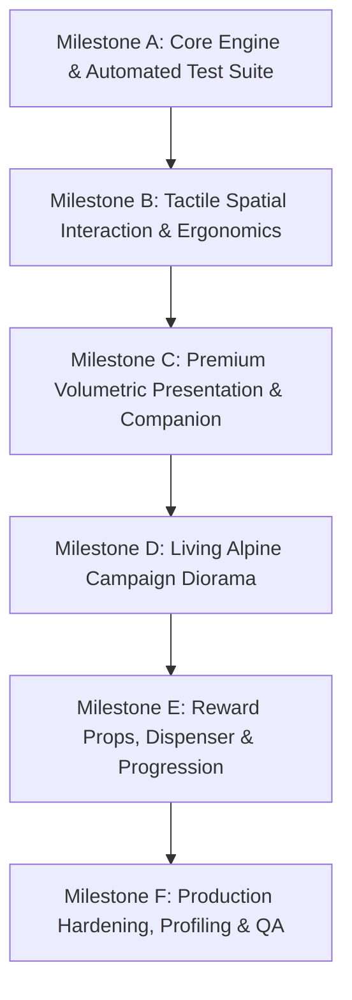

# SUDOKU ZENITH MR — MASTER IMPLEMENTATION PLAN
**Document Reference:** `Documentation/ZenithMR/IMPLEMENTATION_PLAN.md`  
**Date:** October 11, 2026  
**Status:** Approved & Phased for Execution

---

## 1. Architectural Strategy & Phasing

To ensure zero regressions, continuous playability, and high craftsmanship, development is structured into six discrete milestones (**Milestone A** through **Milestone F**). Each milestone enforces explicit automated and observable acceptance gates before proceeding to the next.

---

## 2. Milestone Breakdown & Dependency Order

### Milestone A — Reliable Playable Foundation & Test Suite
**Objective:** Establish 100% deterministic, automated test-backed Sudoku engine with instant catalogue fallback to eliminate generation hitching.
- **Tasks:**
  - **Task A.1:** Create `Assets/_Project/Tests/EditMode/` assembly definition (`ZenithSudoku.Tests.asmdef`) referencing core assemblies.
  - **Task A.2:** Author comprehensive EditMode unit tests covering:
    - `SudokuSolverTests`: Unique solution verification, unsolvable detection, multi-solution counting.
    - `SudokuGeneratorTests`: Verification of generated boards, clue preservation, symmetric puzzles.
    - `SudokuBoardStateTests`: Bitmask validation, candidate note elimination, immutable clue protection.
    - `MoveHistoryTests`: Value and note Undo/Redo invariants.
  - **Task A.3:** Implement `VerifiedPuzzleCatalogue.cs` with pre-validated puzzle seeds for all difficulty tiers to guarantee instant load times and zero frame drops on Meta Quest standalone.
  - **Task A.4:** Run automated tests via `unityMCP.run_tests` and confirm 100% pass rate.
- **Affected Files:**
  - `Assets/_Project/Tests/ZenithSudoku.Tests.asmdef`
  - `Assets/_Project/Tests/EditMode/SudokuCoreTests.cs`
  - `Assets/_Project/Scripts/Core/VerifiedPuzzleCatalogue.cs`
  - `Assets/_Project/Scripts/Core/SudokuGenerator.cs`
- **Validation Gate:** All EditMode tests pass in Unity test runner; puzzle loading returns under 5ms with verified unique solutions.

---

### Milestone B — Spatial Interaction, Dual Modalities & Ergonomics
**Objective:** Deliver flawless near-field index poking and distance ray interaction with physical spring debouncing and grab isolation.
- **Tasks:**
  - **Task B.1:** Refine `CellInteractor.cs` proximity hysteresis ($< 0.32m$ poke, $\ge 0.35m$ laser) with dual-hand tracking smoothing.
  - **Task B.2:** Implement physical tactile button travel ($0.012m$ inward depression, spring resistance, audio-haptic click at $60\%$ threshold) in `Tile3DView.cs` and `TactileKeypadButton.cs`.
  - **Task B.3:** Validate `SpatialBoardAnchor.cs` grab handles with dual-handed scaling, one-handed translation, and strict board-hover grab blocking.
  - **Task B.4:** Wire one-tap recenter and pause menu offset to ensure modals never clip into the board.
- **Affected Files:**
  - `Assets/_Project/Scripts/Interaction/CellInteractor.cs`
  - `Assets/_Project/Scripts/Interaction/Tile3DView.cs`
  - `Assets/_Project/Scripts/Interaction/TactileKeypadButton.cs`
  - `Assets/_Project/Scripts/Interaction/SpatialBoardAnchor.cs`
- **Validation Gate:** Index finger poke and distance ray both select cells cleanly; board grab is impossible while interacting with the 9x9 grid.

---

### Milestone C — Premium Volumetric Visuals & Companion Prototype
**Objective:** Transform tiles and keypad into handcrafted ceramic, enamel, and champagne-metallic surfaces inspired by *Jolly Match 3 MR*, and introduce the 3D animated companion mascot.
- **Tasks:**
  - **Task C.1:** Create URP materials for the luxury material palette (Milk Ceramic, Glazed Sapphire, Champagne Gold Metallic, Frosted Acrylic).
  - **Task C.2:** Upgrade `Tile3DView` and keypad geometry with softly beveled procedural geometry and subtle depth embossing.
  - **Task C.3:** Introduce **Orbi the Star Sprite** companion mascot prototype floating beside the board with procedural idle breathing, thinking animations, and celebratory burst reactions.
  - **Task C.4:** Integrate tactile acoustic sound palette (ceramic taps, wooden clicks, bell chimes, victory fanfare) with independent volume controls.
- **Affected Files:**
  - `Assets/_Project/Art/Materials/` (Ceramic, GoldTrim, EnamelSapphire, FrostedAcrylic)
  - `Assets/_Project/Scripts/Interaction/Tile3DView.cs`
  - `Assets/_Project/Scripts/Interaction/FloatingKeypadView.cs`
  - `Assets/_Project/Scripts/Gameplay/CompanionMascotView.cs`
  - `Assets/_Project/Scripts/Core/TactileAudioService.cs`
- **Validation Gate:** Visual hierarchy matches Jolly Match 3 MR aesthetic standards; zero console errors; companion reacts to gameplay events in real time.

---

### Milestone D — Living Alpine Campaign Diorama
**Objective:** Replace the flat navigation UI with a miniature floating alpine diorama island featuring 5 difficulty zones, level nodes, and persistent star progression.
- **Tasks:**
  - **Task D.1:** Assemble floating miniature diorama island ($0.9m \times 0.6m$) with low-poly terrain, snowy ridges, pines, chalets, and animated cable car.
  - **Task D.2:** Implement interactive level node pedestals with locked, available, and 3-star completion visual states.
  - **Task D.3:** Create `CampaignDioramaController.cs` linking level selection, star persistence, and camera focus.
  - **Task D.4:** Provide a reduced-motion toggle to disable ambient scenery loops for sensitive users.
- **Affected Files:**
  - `Assets/_Project/Scripts/UI/CampaignDioramaController.cs`
  - `Assets/_Project/Scripts/UI/DioramaLevelNode.cs`
  - `Assets/_Project/Scripts/Core/ProgressionManager.cs`
- **Validation Gate:** Selecting level nodes launches verified puzzles; completed puzzles record stars to profile and unlock subsequent nodes.

---

### Milestone E — Tactile Reward Props & Customization
**Objective:** Implement physical arcade reward dispenser and avatar customization stage.
- **Tasks:**
  - **Task E.1:** Create interactive Daily Reward Gumball Dispenser with animated pull lever, tumbling capsules, and star credit grants.
  - **Task E.2:** Create Avatar Profile Stage with customizable backdrops (Bamboo Grove, Alpine Chalet, Cosmic Zenith) and trophy pedestal.
  - **Task E.3:** Prevent duplicate reward grants and ensure state persists safely across application reboots.
- **Affected Files:**
  - `Assets/_Project/Scripts/Gameplay/RewardDispenserProp.cs`
  - `Assets/_Project/Scripts/UI/ProfileStageController.cs`
- **Validation Gate:** Daily rewards trigger exactly once per calendar period; cosmetic changes persist across sessions.

---

### Milestone F — Production Hardening, Profiling & Release QA
**Objective:** Complete full verification, Quest performance profiling, regression tests, and final QA report.
- **Tasks:**
  - **Task F.1:** Run complete EditMode and PlayMode test suites.
  - **Task F.2:** Profile draw calls, SRP batcher compatibility, and GC allocations in tick loops.
  - **Task F.3:** Verify Meta Quest standalone Android build readiness.
  - **Task F.4:** Publish `Documentation/ZenithMR/QA_REPORT.md` and `Documentation/ZenithMR/PERFORMANCE_REPORT.md`.
- **Validation Gate:** Stable target 72/90 FPS draw call budget (<150 draw calls); zero compiler warnings or errors; documented release assessment.

---

## 3. Rollback & Safety Protocol

1. **Version Control Snapshots:** Every milestone boundary commits all affected code, scene objects, and materials to version control.
2. **Non-Destructive Prefab Workflow:** Visual and scene upgrades preserve legacy script references until new controllers are 100% verified.
3. **Emergency Fallback Mode:** If advanced MRUK or hand-tracking features are unavailable on a given test headset, the game automatically falls back to 3-DOF controller laser pointers and stationary desk placement.
