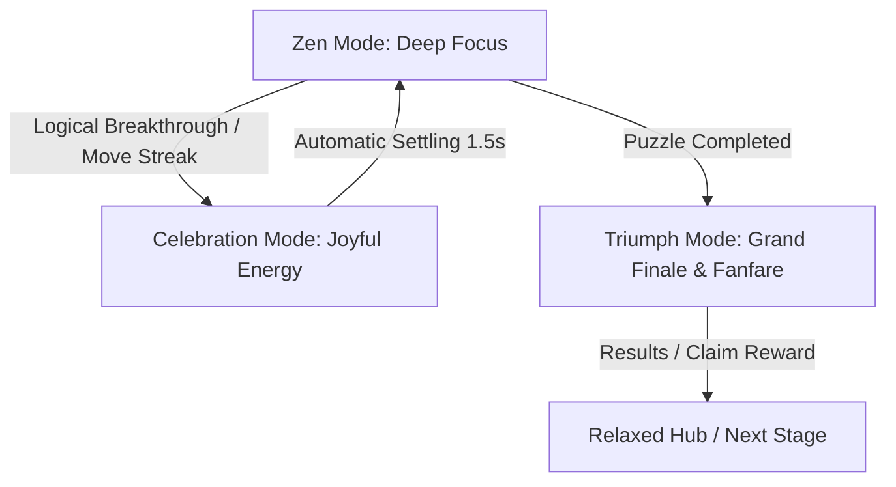
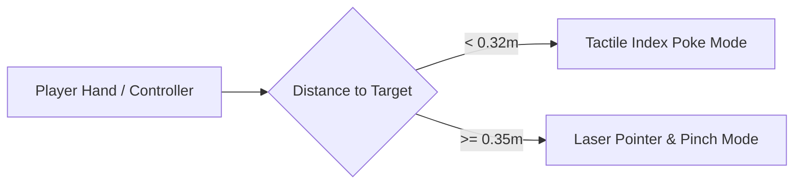
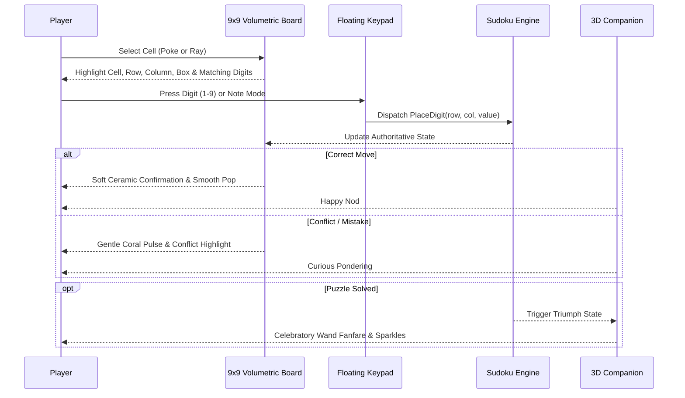

# SUDOKU ZENITH MR — PRODUCT AND UX SPECIFICATION
**Document Reference:** `Documentation/ZenithMR/PRODUCT_AND_UX_SPEC.md`  
**Date:** October 11, 2026  
**Status:** Approved Specification

---

## 1. Product Vision & Emotional Architecture

### 1.1 Product Statement
**Sudoku Zenith MR** is a premier, tactile, mixed-reality spatial puzzle game for Meta Quest that transforms classical logical Sudoku into a rich physical ritual. Inspired by the craftsmanship, playfulness, and tactile delight of high-end casual MR games (such as *Jolly Match 3 MR*), the game seamlessly balances deep logical zen with joyful, expressive celebrations.

### 1.2 Dual Emotional Modes
The core experience is architected around two complementary emotional states:



1. **Zen Mode (Focus State):**
   - High legibility, calm color palette, soft ambient environmental grounding.
   - Gentle, subdued spatial acoustics (soft ceramic taps, muted clicks).
   - Zero distracting peripheral motion or floating neon clutter.
   - Companion character rests peacefully in an attentive, supportive pose.

2. **Celebration Mode (Breakthrough & Milestone State):**
   - Triggered upon placing single-candidate breakthroughs, completing 3x3 houses, or completing full puzzles.
   - Dynamic particle sparkles (clamped, soft alpha), champagne-gold metallic glints, and celebratory audio chimes.
   - Companion character bursts with playful delight (happy bounce, wand wave, celebratory dance).
   - **Crucial Rule:** The system automatically settles back into calm Zen Mode within 1.5 to 2.0 seconds, never blocking or interrupting subsequent player moves.

---

## 2. Visual Identity & Art Direction

### 2.1 Material Hierarchy & Physicality
Inspired by handcrafted porcelain, glazed ceramic, and brushed metallics:

| Layer | Material Type | Finish & Optical Properties | Color Palette |
| :--- | :--- | :--- | :--- |
| **1. Primary Board Cells** | Glazed Enamel / Fine Ceramic | High smoothness (0.85), subtle subsurface scattering, softly rounded beveled edges | Milk White (`#F8F9FA`), Slate Charcoal (`#212529`) for contrast |
| **2. Immutable Clues** | Deep Inset Ceramic | Engraved matte finish, recessed by 2mm into tile surface | Obsidian Black (`#1A1A1A`) |
| **3. Player Placed Digits** | Glossy Raised Porcelain | Raised by 1.5mm, vibrant jewel tone | Royal Sapphire (`#2B6CB0`) |
| **4. Interactive Controls & Keypad** | Tactile Soft-Touch Acrylic | Pill-shaped capsules, translucent frosted sheen (opacity 0.9) | Warm Alabaster (`#EDF2F7`), Soft Champagne (`#D69E2E`) |
| **5. Selection & Accents** | Polished Champagne Metal | Brushed gold metallic (metallic 0.85, smoothness 0.8), soft warm reflection | Champagne Gold (`#ECC94B`) |
| **6. Error & Conflict** | Coral Velvet Matte | Soft non-aggressive warning glow, zero blinding red flashes | Soft Coral (`#E53E3E`) |

### 2.2 Board Ergonomics & Geometry
- **Monolith Orientation:** Stands vertically like a premium desk kiosk ($5^\circ$ backward inclination), avoiding neck fatigue associated with horizontal table boards.
- **Viewing Distance:** Default distance $0.65m$ to $0.75m$ directly in front of the player's head, height-aligned with the chin/chest line.
- **Physical Tile Size:** $0.052m \times 0.052m \times 0.015m$ with $0.004m$ spacing between cells, producing an active 9x9 grid footprint of $0.50m \times 0.50m$.
- **3x3 Box Framing:** Recessed champagne-gold grooves ($0.006m$ wide) distinctly grouping the nine 3x3 subgrids without harsh black grid lines.

---

## 3. Spatial Interaction Model

### 3.1 Hand Tracking & Input Modalities
The system seamlessly supports both Meta Quest Hand Tracking and Touch Plus Controllers with zero configuration needed.



#### Modality 1: Tactile Index Poke (< 0.32m)
- **Activation:** Automatically enabled when the player's index finger tip enters the near-field volume ($< 0.32m$ from board).
- **Behavior:**
  - Pointers and laser rays automatically fade out to eliminate visual distraction.
  - A small, translucent proximity orb ($0.012m$ diameter) appears on the index fingertip.
  - Depressing a cell pushes the visual tile physically inward by up to $0.012m$ against a virtual spring.
  - Activation fires at $60\%$ depression with an acoustic ceramic click and subtle controller haptic pulse.
  - Spring-release returns the tile smoothly with subtle overshoot settling.

#### Modality 2: Distance Pointer & Pinch (>= 0.35m)
- **Activation:** Automatically enabled when hands or controllers move beyond $0.35m$.
- **Behavior:**
  - Subtle, tapered pointer ray projects from the wrist/controller.
  - Reticle cursor displays a rounded disc on the targeted cell with dynamic hover scale.
  - Index pinch (or controller index trigger) selects the cell or presses the keypad button.

### 3.2 Spatial Manipulation & Placement
- **Grab Handles:** Two sculptural champagne-gold handles positioned on the left and right borders of the board.
- **One-Handed Grab:** Grabbing either handle allows smooth 6-DOF translation and yaw rotation.
- **Two-Handed Pinch-Scale:** Grabbing both handles simultaneously allows two-handed scaling (clamped between $0.6\times$ and $1.5\times$ scale) and full rotational alignment.
- **Input Isolation:** Grabbing is strictly inhibited whenever hand pointers or index fingers hover over the active 9x9 grid, preventing accidental moves while solving puzzles.
- **One-Tap Recenter:** A dedicated floating recenter button allows players to instantly recall the board to their comfortable front viewing sphere at any time.

---

## 4. Sudoku Game Loop & Mechanics

### 4.1 Core Gameplay Loop


### 4.2 Number Tray & Selection Memory
- **Dual Input Modes:**
  1. **Cell-First Entry:** Select a cell $\rightarrow$ Tap digit 1-9 on keypad. Keypad remembers selection.
  2. **Digit-First Rapid Placement:** Select digit on keypad $\rightarrow$ Rapidly tap multiple target cells on the board.
- **Exhausted Numbers:** When all 9 instances of a digit are correctly placed on the board, the corresponding keypad button transitions to a soft disabled state with a golden checkmark, preventing accidental redundant placements.
- **Pencil Marks (Candidate Notes):**
  - Toggle "Notes Mode" button on keypad.
  - Digits entered in Notes Mode render as a 3x3 sub-grid of miniature, high-contrast numerals inside the cell.
  - Candidate elimination: When a committed number is confirmed in a cell, matching candidate notes across its row, column, and box are automatically eliminated.

### 4.3 Assistance & Hint Engine
- **Intelligent Hints:** Hints never reveal random digits without context.
- **Deduction Levels:**
  1. Level 1: Naked Single (identifies cell with only one valid candidate).
  2. Level 2: Hidden Single (identifies candidate unique to a row, col, or box).
  3. Level 3: Naked Pair / Locked Candidate.
- **Presentation:** The companion mascot points with its star wand toward the relevant region, softly highlighting the logical deduction, while a non-intrusive floating toast displays the reasoning.

---

## 5. Companion Mascot System

### 5.1 Character Identity: "Orbi the Star Sprite"
- **Form:** A charming, pearlescent spherical sprite with floating mitten hands, expressive starry eyes, and a magical star wand.
- **Positioning:** Floating gracefully $0.25m$ to the right or left of the board (user-switchable or auto-adapting), slightly forward.
- **Behaviors & Emotional States:**
  1. `Idle`: Gentle levitation, periodic subtle blinks, observing the player's cursor.
  2. `Thinking`: Triggered when player pauses for $> 15s$; Orbi taps chin thoughtfully.
  3. `Hinting`: Floats toward the hinted cell and indicates the deduction with wand sparkle.
  4. `Encourage`: Celebrates streaks of 3 or 5 consecutive logical placements.
  5. `Victory`: Full celebratory spin, floating loop-de-loop, bursting confetti stars.

---

## 6. Living Alpine Diorama Campaign

### 6.1 Spatial Diorama Concept
Replacing flat UI canvases, the Campaign Map is a floating miniature alpine diorama island ($0.9m \times 0.6m \times 0.3m$) floating in front of the player.

### 6.2 Thematic Alpine Zones
1. **Alpine Village (Levels 1–10):** Gentle meadows, timber cottages, warm lamp posts (Beginner difficulty).
2. **Pine Forest (Levels 11–25):** Deep evergreen woods, stone footbridges, gentle stream (Easy difficulty).
3. **Snowy Peak (Levels 26–50):** Crisp snowdrifts, cozy ski chalets, moving miniature cable car (Medium difficulty).
4. **Glacier Ridge (Levels 51–75):** Crystalline ice arches, frozen waterfalls, alpine observatory (Hard difficulty).
5. **Volcanic Summit (Levels 76–100):** Steaming thermal hot springs, obsidian rock faces, gold zenith shrine (Grandmaster difficulty).

### 6.3 Level Nodes & Progression
- Each level is represented as a carved stone pedestal on the winding path.
- Visual States: Locked (padlock with snow covering), Available (soft golden glow), Completed (1, 2, or 3 gold stars).
- Tapping a node brings up an elegant pop-up briefing showing best time, stars, and play button.

---

## 7. Persistence & Game State Specification

### 7.1 Save Schema (`Application.persistentDataPath/zenith_sudoku_profile.json`)
```json
{
  "version": 2,
  "lastPlayedTimestamp": 1791750000,
  "activeGame": {
    "hasActiveGame": true,
    "difficulty": 2,
    "boardValues": [ ... 81 bytes ... ],
    "initialClues": [ ... 81 booleans ... ],
    "pencilNotes": [ ... 81 ushorts ... ],
    "elapsedSeconds": 142.5,
    "mistakesCount": 1,
    "score": 1250
  },
  "progression": {
    "unlockedLevelIndex": 14,
    "starsPerLevel": { "1": 3, "2": 3, "3": 2, ... },
    "totalPuzzlesCompleted": 13,
    "bestTimes": { "Beginner": 94.2, "Easy": 182.1 }
  },
  "settings": {
    "passthroughEnabled": true,
    "masterVolume": 0.8,
    "hapticsEnabled": true,
    "handPointerPreferred": "Right",
    "reducedMotion": false
  }
}
```

---

## 8. Accessibility & Ergonomics Standards

1. **Colorblind Independence:**
   - Redundant visual cues: Every color state (selection, conflict, clue) is accompanied by distinct geometric depth, border thickness, and icon markings.
2. **Seated & Standing Adaptation:**
   - One-tap recenter recalibrates the board height directly to the current headset eye height.
3. **Reduced Motion Setting:**
   - Disables diorama ambient animations (cable car, wind turbines) and companion loop-de-loops for motion-sensitive players.
4. **Distance Independence:**
   - Full gameplay is $100\%$ playable via distance laser ray casting from up to $3.0m$ away, requiring zero physical arm reach.
